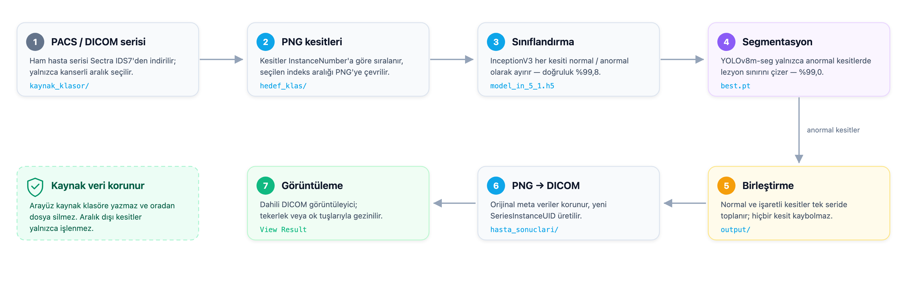
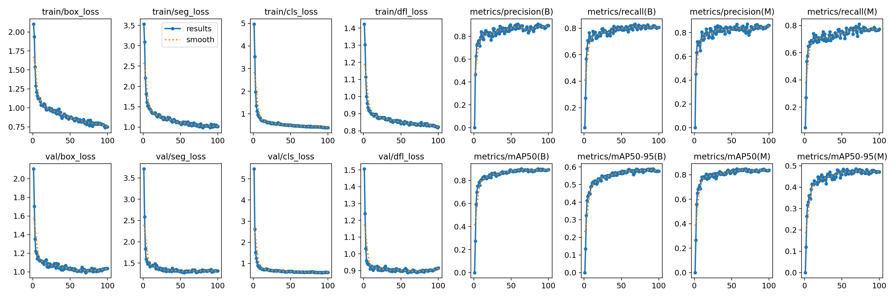
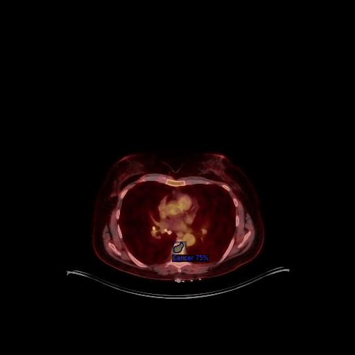
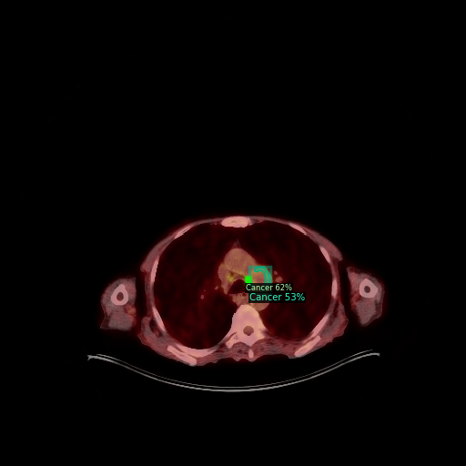
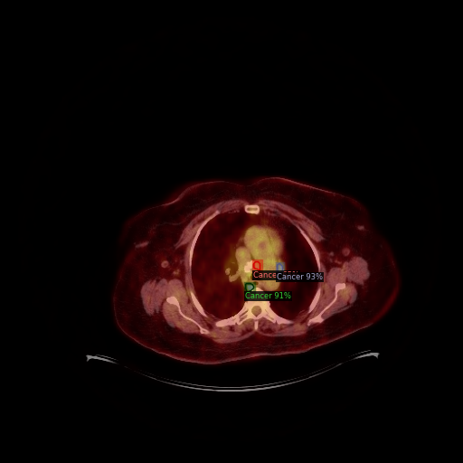
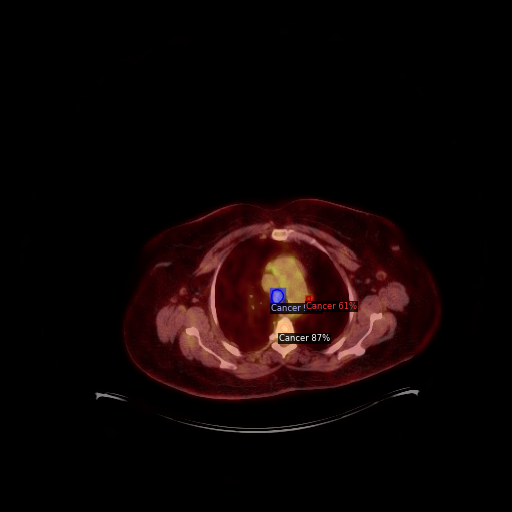

# LungScan-AI

**Yapay zekâ tabanlı akciğer kanseri tespiti ve görüntülenmesi (LungScan)**

Akciğer BT (toraks bilgisayarlı tomografi) kesitlerinde kanserli lezyonun otomatik tespiti ve segmentasyonu.

Bu proje, DICOM formatındaki akciğer BT serilerini alıp her kesiti *normal* / *anormal* olarak
sınıflandıran, anormal kesitlerdeki lezyon bölgesini segmente ederek işaretleyen ve sonucu
tekrar DICOM formatında üreten uçtan uca bir çalışma hattıdır.

> Bitirme projesi olarak geliştirilmiştir. Kod, geliştirme sürecindeki farklı yaklaşımların
> (CNN sınıflandırma, SVM, U-Net, Mask R-CNN, YOLOv8-seg) karşılaştırılmasını ve nihai
> uygulamayı bir arada içerir.

---

## İçindekiler

- [Genel Bakış](#genel-bakış)
- [Sistem Mimarisi](#sistem-mimarisi)
- [Depo Yapısı](#depo-yapısı)
- [Kurulum](#kurulum)
- [Model Ağırlıkları](#model-ağırlıkları)
- [Kullanım](#kullanım)
- [Veri Kümesi](#veri-kümesi)
- [Sonuçlar](#sonuçlar)
  - [Örnek Çıktılar](#örnek-çıktılar)
- [Makale](#makale)
- [Notebook Rehberi](#notebook-rehberi)
- [Gizlilik ve Etik Not](#gizlilik-ve-etik-not)
- [Lisans](#lisans)

---

## Genel Bakış

Geleneksel olarak akciğer BT değerlendirmesi radyologların dilim dilim incelemesini gerektirir ve
zaman alıcıdır. LungScan, bu süreci iki aşamalı bir derin öğrenme hattıyla otomatikleştirmeyi amaçlar:

| Aşama | Görev | Model |
|---|---|---|
| 1 | Kesit sınıflandırma (normal / anormal) | InceptionV3 tabanlı CNN (`model_in_5_1.h5`) |
| 2 | Lezyon segmentasyonu | YOLOv8m-seg (`best.pt`) |

Sınıflandırma aşaması, incelenecek kesit sayısını ciddi biçimde azaltır; segmentasyon aşaması ise
yalnızca anormal bulunan kesitlerde çalışarak lezyonun sınırını görünür hale getirir.

## Sistem Mimarisi

Projenin özgün akış şeması — hasta verisinin PACS'ten indirilmesinden sonuçların
görüntülenmesine kadar tüm süreç:



Bileşen düzeyindeki akış:

```
  ┌─────────────────┐
  │  DICOM serisi   │   kaynak_klasor/
  └────────┬────────┘
           │  (1) InstanceNumber'a göre sıralama, aralık filtresi
           ▼
  ┌─────────────────┐
  │   PNG kesitler  │   hedef_klas/
  └────────┬────────┘
           │  (2) Keras CNN sınıflandırıcı
           ▼
   ┌───────┴────────┐
   ▼                ▼
 normal/         abnormal/
   │                │  (3) YOLOv8m-seg lezyon segmentasyonu
   │                ▼
   │           segmented/         (lezyon konturu çizilmiş kesitler)
   │                │
   └───────┬────────┘
           │  (4) Birleştirme
           ▼
        output/
           │  (5) Orijinal DICOM meta verisiyle eşleştirme
           ▼
   hasta_sonuclari/  ──(6)──►  Dahili DICOM görüntüleyici
```

## Depo Yapısı

```
LungScan-AI/
├── app/
│   ├── lungscan_gui.py                  # Nihai Tkinter arayüzü (uçtan uca hat)
│   ├── run_lungscan.bat                 # Windows başlatıcı
│   └── legacy/
│       └── lungscan_gui_v1.py           # Arayüzün önceki sürümü (arşiv)
├── notebooks/
│   ├── 01_veri_hazirlama.ipynb              # DICOM → PNG, etiket → maske → YOLO etiketi
│   ├── 02_siniflandirma_vgg16.ipynb         # VGG16 transfer öğrenmesi (6 varyant)
│   ├── 03_siniflandirma_inceptionv3.ipynb   # ★ Üretim sınıflandırıcısı (model_in_5_1.h5)
│   ├── 04_degerlendirme_konfuzyon_matrisi.ipynb   # Giriş boyutu ablasyonu + metrikler
│   ├── 05_segmentasyon_unet.ipynb           # U-Net piksel segmentasyonu
│   ├── 06_segmentasyon_detectron2.ipynb     # Mask R-CNN (Detectron2)
│   ├── 07_segmentasyon_yolov8.ipynb         # ★ Üretim segmentasyonu (best.pt)
│   ├── 08_cikarim_pipeline.ipynb            # Uçtan uca çıkarım hattı (arayüzün prototipi)
│   └── denemeler/                           # Yöntem denemeleri (üretimde kullanılmaz)
│       ├── svm_ozellik_cikarimi.ipynb       # VGG16 öznitelikleri + SVM
│       ├── goruntu_isleme_denemeleri.ipynb  # Otsu, parlak bölge, watershed
│       └── yolov8_model_karsilastirmasi/    # n → n(50 epoch) → m → l → x
│           ├── yolov8n.ipynb
│           ├── yolov8n_50epoch.ipynb
│           ├── yolov8m.ipynb
│           ├── yolov8l.ipynb
│           └── yolov8x.ipynb
├── scripts/
│   ├── annotation_filter.py             # Boş segmentasyonlu etiketleri ayıklar
│   ├── json_temizleme.ipynb             # COCO JSON temizleme
│   ├── train_yolov8_seg.py              # Eğitimin betik sürümü
│   ├── qupath_export_json.groovy        # QuPath: görüntü başına COCO JSON
│   └── qupath_merge_json.groovy         # QuPath: tek COCO JSON'da birleştirme
├── configs/
│   ├── lungscan_yolo_dataset.yaml       # YOLO veri kümesi tanımı
│   └── mask_rcnn_R_50_FPN_3x.yaml       # Detectron2 model yapılandırması
├── results/
│   ├── train_yolov8m_seg/               # Eğitim eğrileri ve karmaşıklık matrisi
│   └── val_yolov8m_seg/                 # Doğrulama tahmin görselleri
├── docs/
│   ├── images/                          # Akış şeması ve örnek çıktılar
│   └── makale/                          # Bitirme projesi makalesi (TR + EN PDF)
├── requirements.txt
├── CITATION.cff                         # Akademik atıf bilgisi
├── DISCLAIMER.md                        # Yasal ve etik uyarı
└── LICENSE                              # MIT
```

> **Not:** Veri kümesi ve model ağırlıkları, hasta gizliliği ve dosya boyutu nedeniyle
> bu depoya **dahil edilmemiştir**; nasıl elde edileceği aşağıda açıklanmıştır.

## Kurulum

```bash
git clone https://github.com/bahadirmkl/LungScan-AI.git
cd LungScan-AI
python -m venv .venv && source .venv/bin/activate      # Windows: .venv\Scripts\activate
pip install -r requirements.txt
```

Proje Python 3.10–3.11 ile geliştirilmiştir.

> **Apple Silicon (M serisi) notu:** TensorFlow için
> `pip install tensorflow-macos` gerekebilir. Yalnızca notebook'ları inceleyecekseniz
> TensorFlow kurmak zorunda değilsiniz.

## Model Ağırlıkları

Ağırlıklar depo boyutunu şişirmemek için [**Releases**](https://github.com/bahadirmkl/LungScan-AI/releases)
bölümünde yayınlanır. İndirip `app/` klasörüne koyun:

| Dosya | Açıklama | Boyut |
|---|---|---|
| `best.pt` | YOLOv8m-seg lezyon segmentasyon modeli | ~52 MB |
| `model_in_5_1.h5` | Keras CNN sınıflandırıcı (normal / anormal) — **uygulama bunu kullanır** | ~298 MB |
| `model_in_3.h5` | Keras CNN sınıflandırıcının önceki sürümü (arşiv) | ~298 MB |

```bash
# v1.0.0 sürümündeki ağırlıkları indir
BASE=https://github.com/bahadirmkl/LungScan-AI/releases/download/v1.0.0

curl -L -o app/best.pt          "$BASE/best.pt"
curl -L -o app/model_in_5_1.h5 "$BASE/model_in_5_1.h5"
```

Doğrulama (indirdikten sonra):

```bash
shasum -a 256 app/best.pt
# 9ef3dfbce1694af43a0f07f7152211904209536750f27ea8e0da8304b22742d2
```

Ağırlıkları sıfırdan üretmek isterseniz `notebooks/03_siniflandirma_inceptionv3.ipynb`
(sınıflandırıcı) ve `notebooks/07_segmentasyon_yolov8.ipynb` (segmentasyon)
notebook'larını kullanabilirsiniz.

## Kullanım

```bash
cd app
python lungscan_gui.py
```

Arayüz altı adımı sırayla yürütür:

1. **Start Process** – DICOM serisini temizler, verilen indeks aralığındaki kesitleri PNG'ye çevirir.
2. **Start Prediction** – Kesitleri sınıflandırır, anormal olanları segmente eder,
   sonuçları birleştirir ve tekrar DICOM'a dönüştürür.
3. **View Result** – Üretilen DICOM serisini dahili görüntüleyicide açar
   (fare tekerleğiyle dilimler arasında gezinilir).
4. **Restart** – Ara klasörleri temizleyerek başlangıç durumuna döner.

### Çalışma klasörü

Varsayılan olarak betiğin bulunduğu klasör kullanılır. Farklı bir konum için:

```bash
export LUNGSCAN_WORK_DIR=/path/to/calisma_alani
export LUNGSCAN_MODEL_DIR=/path/to/modeller
python app/lungscan_gui.py
```

Beklenen klasör yapısı:

```
<WORK_DIR>/
├── kaynak_klasor/      # ham DICOM serisi (girdi)
├── hedef_klas/         # DICOM → PNG çıktısı
├── normal/             # sınıflandırıcı: normal kesitler
├── abnormal/           # sınıflandırıcı: anormal kesitler
├── segmented/          # lezyon konturu çizilmiş kesitler
├── output/             # normal + segmented birleşimi
└── hasta_sonuclari/    # sonuç DICOM serisi (çıktı)
```

## Veri Kümesi

Eğitim verisi, kurumun PACS sisteminden **Sectra IDS7** ile dışa aktarılan anonimleştirilmiş
toraks BT serilerinden oluşturulmuştur.

| Özellik | Değer |
|---|---|
| Toplam görüntü | 789 eğitim / 198 doğrulama kesiti |
| Sınıf sayısı | 1 (`Cancer`) |
| Etiketleme aracı | QuPath (COCO JSON) → YOLO polygon formatı |
| Görüntü formatı | 8-bit PNG (DICOM'dan dönüştürülmüş) |

Etiketleme akışı:

```
QuPath projesi  ──(qupath_export_json.groovy)──►  görüntü başına COCO JSON
                 ──(qupath_merge_json.groovy)──►  tek COCO JSON
                 ──(annotation_filter.py)──────►  boş segmentasyonlar ayıklanır
                 ──(json_temizleme.ipynb)──────►  YOLO formatı (.txt)
```

Veri kümesi kişisel sağlık verisi içerdiği için bu depoda **paylaşılmamaktadır**.

## Sonuçlar

Nihai model: **YOLOv8m-seg**, 100 epoch, `imgsz=640`, `batch=64`, SGD (`lr0=0.001`),
tek sınıf. Eğitim parametrelerinin tamamı `results/train_yolov8m_seg/args.yaml` içindedir.

| Görev | Precision | Recall | mAP@50 | mAP@50-95 |
|---|---|---|---|---|
| Box (tespit) | 0.894 | 0.807 | 0.893 | 0.576 |
| Mask (segmentasyon) | 0.861 | 0.773 | 0.838 | 0.472 |



Ayrıntılı eğriler, karmaşıklık matrisi ve doğrulama tahminleri için
[`results/`](results/) klasörüne bakın.

Proje sunumunda raporlanan uçtan uca başarı oranları: sınıflandırma modeli **%99.8**,
lezyon tespiti **%99.0**. Bu değerler projeye özel veri kümesi üzerinde elde edilmiştir
ve genelleme performansı hakkında bilgi vermez.

### Örnek Çıktılar

Sınıflandırma + segmentasyon hattının anonimleştirilmiş BT kesitleri üzerindeki
çıktıları (yeşil kutu: tespit edilen lezyon ve güven skoru):

| | |
|---|---|
|  |  |
|  |  |

## Makale

Bu çalışmanın bitirme projesi makalesi, Akdeniz Üniversitesi Elektrik-Elektronik Mühendisliği
Bölümü'nde **Doç. Dr. H. Feza Carlak** danışmanlığında hazırlanmıştır.

**Akciğer Kanser Tanılı Hastalarda Kanserli Doku Tespiti İçin Yapay Zeka Yöntemleri
Kullanılarak Kanserli Bölgenin Konturlanması**

| Sürüm | Dosya |
|---|---|
| Türkçe (özgün) | [`docs/makale/LungScan-Makale-TR.pdf`](docs/makale/LungScan-Makale-TR.pdf) |
| English (translation) | [`docs/makale/LungScan-Paper-EN.pdf`](docs/makale/LungScan-Paper-EN.pdf) |

> Makalede raporlanan sonuçlar ile bu depodaki notebook çıktıları aynı deneylere aittir.
> Makale, hakem değerlendirmesinden geçmiş bir yayın değildir; metrikler yalnızca projeye
> özel veri kümesi üzerinde elde edilmiştir.

## Notebook Rehberi

Proje boyunca farklı yaklaşımlar denenmiş ve karşılaştırılmıştır. Numaralandırma, veri
hazırlamadan dağıtıma giden sırayı izler; `★` işaretli iki notebook depodaki model
ağırlıklarını üretir.

| # | Notebook | Yaklaşım | Not |
|---|---|---|---|
| 01 | [`01_veri_hazirlama`](notebooks/01_veri_hazirlama.ipynb) | — | DICOM → PNG, etiket → maske → YOLO etiketi, train/val ayrımı |
| 02 | [`02_siniflandirma_vgg16`](notebooks/02_siniflandirma_vgg16.ipynb) | VGG16 + tam bağlı başlık | 6 varyantın karşılaştırması |
| 03 | [`03_siniflandirma_inceptionv3`](notebooks/03_siniflandirma_inceptionv3.ipynb) | InceptionV3 + ince ayar | ★ Üretim sınıflandırıcısı (`model_in_5_1.h5`) |
| 04 | [`04_degerlendirme_konfuzyon_matrisi`](notebooks/04_degerlendirme_konfuzyon_matrisi.ipynb) | VGG16 @512² | Giriş boyutu ablasyonu ve karışıklık matrisi |
| 05 | [`05_segmentasyon_unet`](notebooks/05_segmentasyon_unet.ipynb) | U-Net | Piksel düzeyinde segmentasyon, IoU/Dice |
| 06 | [`06_segmentasyon_detectron2`](notebooks/06_segmentasyon_detectron2.ipynb) | Mask R-CNN (Detectron2) | İki aşamalı tespit + segmentasyon |
| 07 | [`07_segmentasyon_yolov8`](notebooks/07_segmentasyon_yolov8.ipynb) | YOLOv8m-seg | ★ Üretim segmentasyonu (`best.pt`) |
| 08 | [`08_cikarim_pipeline`](notebooks/08_cikarim_pipeline.ipynb) | — | Arayüzün Colab prototipi (uçtan uca hat) |

Model boyutu etkisi
[`notebooks/denemeler/yolov8_model_karsilastirmasi/`](notebooks/denemeler/yolov8_model_karsilastirmasi/)
altında n → n(50 epoch) → m → l → x sırasıyla karşılaştırılmıştır. Sonuç: **`yolov8m`**
doğruluk/hız dengesi açısından en uygun seçimdir.

Üretimde kullanılmayan denemeler (klasik görüntü işleme, SVM öznitelik çıkarımı)
[`notebooks/denemeler/`](notebooks/denemeler/) altında ayrı tutulur.

## Gizlilik ve Etik Not

- Bu depoda **hiçbir hasta verisi, DICOM dosyası veya kişisel sağlık bilgisi bulunmaz.**
- Notebook çıktılarında yer alan örnek kesitler, PACS'ten anonimleştirilerek dışa aktarılmıştır.
- Makale PDF'lerinde hasta adı, protokol numarası veya yakılmış (burned-in) kimlik bilgisi yoktur;
  DICOM meta verileri (hasta adı, TCKN, çekim tarihi, kurum bilgisi) dönüştürme sırasında
  tamamen kaldırılmıştır.
- Model ağırlıkları ve veri kümesi ayrı tutulur.
- **Bu yazılım yalnızca akademik araştırma amaçlıdır. Klinik teşhis aracı değildir.**
  Hiçbir tıbbi karar bu sistemin çıktısına dayandırılmamalıdır.

Ayrıntılı yasal ve etik uyarı için: [`DISCLAIMER.md`](DISCLAIMER.md)

## Lisans

[MIT](LICENSE) © 2024 İhsan Bahadır Emekli

Kod MIT lisansı altındadır. Tıbbi kullanım kısıtları için [`DISCLAIMER.md`](DISCLAIMER.md)
dosyasına bakın.

---

## English Summary

**LungScan-AI** is an end-to-end deep learning pipeline for detecting and segmenting
cancerous lesions in thoracic CT scans. It classifies each slice as *normal* or *abnormal*
using an InceptionV3-based CNN, segments the lesion in abnormal slices with YOLOv8m-seg, and
writes the results back to DICOM format. The repository contains the final application, the
full set of training/evaluation notebooks (VGG16, InceptionV3, SVM, U-Net, Mask R-CNN,
YOLOv8-seg), the data preparation scripts used with QuPath annotations, and the project paper
(Turkish original + English translation) under `docs/makale/`.

Trained YOLOv8m-seg reaches **0.893 box mAP@50** and **0.838 mask mAP@50** on the validation
split. Model weights are distributed via GitHub Releases. For academic research only —
not a clinical diagnostic tool.
